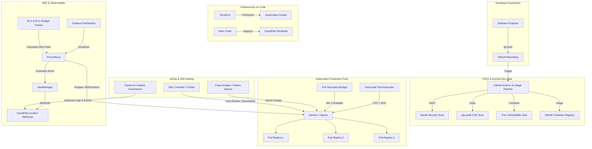

# CloudPilot Architecture & Platform Design

CloudPilot is a production-grade, self-healing cloud-native reliability and internal platform engineering framework built to operate applications on Kubernetes with Google SRE methodologies, DevSecOps principles, and automated incident triage.

---

## 1. System Components

### 1.1 Microservices API Application (`app/`)
Built with **FastAPI** and **Python 3.12**, the application serves high-throughput cloud resource inventory operations (`/api/v1/items`), exposes real-time SLO metrics (`/api/v1/slo`), and maintains operational incident logs (`/api/v1/incidents`).
- **Telemetry**: Instrumented with Prometheus collectors for request throughput, latency histograms, error counts, and active connections.
- **Probes**: Exposes dedicated `/live`, `/ready`, and `/health` endpoints following cloud-native contract requirements.
- **Chaos Interceptors**: In-memory middleware capable of simulating latency, error bursts, and CPU starvation.

### 1.2 Automated CI/CD & DevSecOps Pipeline (`.github/workflows/`)
A 10-stage continuous delivery pipeline guaranteeing code quality, security compliance, and zero-downtime rolling updates:
1. **Linting & Code Quality**: Enforces Black, isort, and Flake8 compliance.
2. **Automated Testing**: Pytest suite verifying >80% test coverage.
3. **SAST Scan**: Bandit scans Python code for AST security vulnerabilities.
4. **Dependency Audit**: `pip-audit` cross-references lockfiles with known CVE databases.
5. **Multi-Stage Container Build**: Hardened, non-root image with minimal runtime surface.
6. **Container Security Gate**: Trivy scans container layers, halting builds on CRITICAL/HIGH vulnerabilities.
7. **Artifact Registry**: Images pushed with immutable commit SHAs to `ghcr.io`.
8. **Staging Rollout**: Rolling deployment to Kubernetes with configured Surge and MaxUnavailable limits.
9. **Automated Smoke Test**: Curled health and SLO endpoints verify live functionality.
10. **Automated Rollback**: If health checks or smoke tests fail, `kubectl rollout undo` is automatically executed.

### 1.3 Infrastructure as Code (`terraform/`)
Declarative infrastructure provisioning managing:
- Kind local cluster or AWS EKS managed nodes.
- Isolated namespaces (`cloudpilot`, `monitoring`).
- RBAC ServiceAccounts, Roles, and RoleBindings.
- Pre-configured `kube-prometheus-stack` via Helm provider.

### 1.4 SRE & Observability Stack (`monitoring/`)
- **Prometheus**: 15s scrape interval with PromQL alerting rules for multi-window burn rate detection:
  - *Fast Burn Alert*: Fires when error budget burns at >14.4x rate (1h window).
  - *Slow Burn Alert*: Fires when error budget burns at >6x rate (6h window).
- **Grafana**: Pre-provisioned dashboards visualizing SLO availability gauges, request heatmaps, P99 latency percentiles, error rate curves, and HPA replica tracking.
- **AlertManager**: Alert routing to webhooks with automated incident creation.

### 1.5 Self-Healing & Chaos Engineering (`chaos/`)
Allows resilience verification through deliberate failure injection:
- Random pod terminations (verifying ReplicaSet & Pod Disruption Budgets).
- Latency injection (verifying timeout handling and degraded readiness).
- Error rate spiking (verifying error budget consumption and fast burn alerts).
- CPU starvation (verifying Horizontal Pod Autoscaler scale-out).
Measures automated **Mean Time to Recovery (MTTR)** and detection latency.

### 1.6 AIOps Incident Summarizer (`ai/`)
Powered by the **Gemini API** (`gemini-3.8-flash`):
- Ingests Kubernetes event streams, container termination reasons, and metric snapshots during an incident.
- Generates structured root cause hypotheses, blast radius assessments, and prioritized remediation runbooks.
- Strict read-only advisory architecture: AI provides recommendations for human or playbook action, avoiding unsafe autonomous infrastructure modifications.
